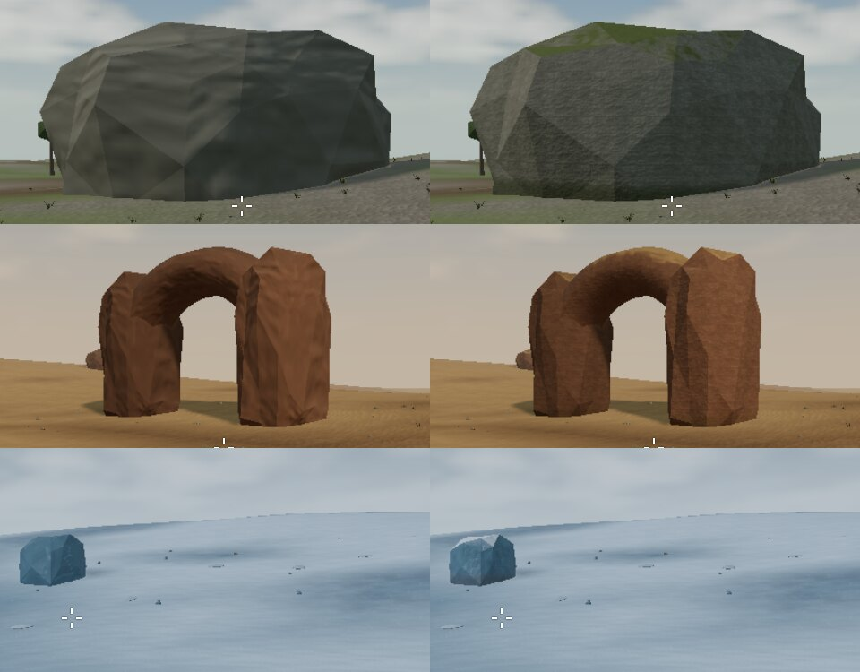
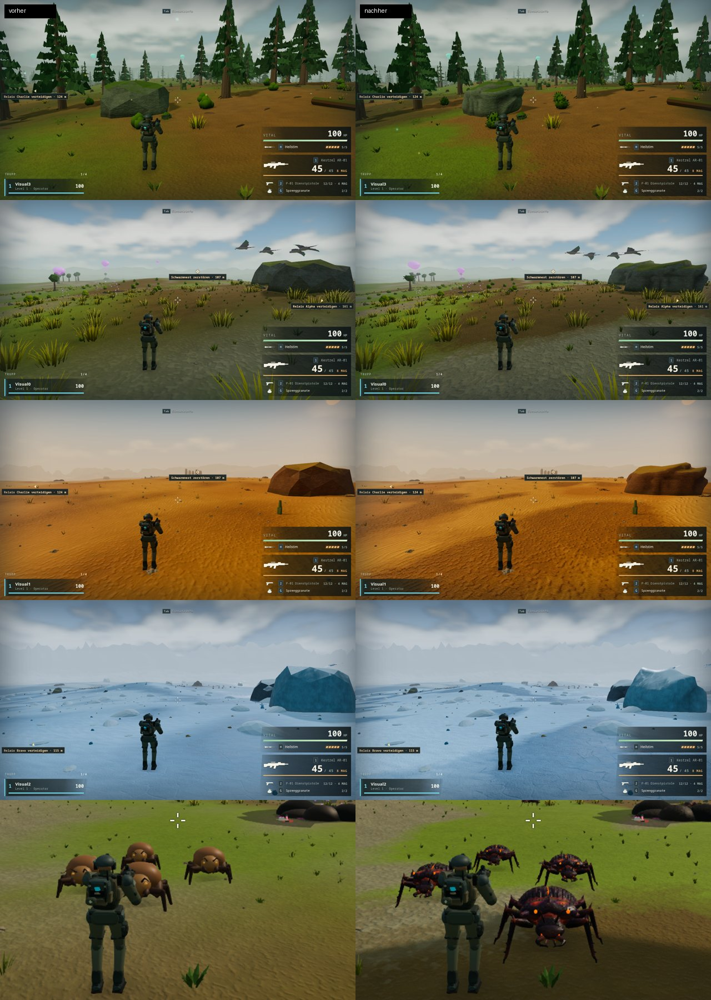

# FREEFALL · Umgebungsmaterialien

## Audit der 7.7A-Baseline

Geprüft wurde die Arbeitskopie von 7.7A auf Basis von `4daf04e`. Die Arbeitskopie enthielt bereits uncommittete Implementierung aus den vorigen Meilensteinen und wurde vor den Änderungen für den Vergleich eingefroren.

| Priorität | Status vor 7.7B | Bestand und Befund |
| --- | --- | --- |
| 1 | FUNCTIONAL FALLBACK | Alle generierten Planeten bezogen dieselbe 256²-Erdalbedo und -normalen aus `SurfaceMaterials.ts`. Planetentöne, interpolierte Steigungsfarbe und UVs mit 4,8 m Wiederholung prägten den Boden. Die Erd-Roughnessmap war beim generierten Terrain ungenutzt. |
| 1 | MISSING | Schichtspezifische Roughness, Eisrisse, Sandrippel, Moos und Blattstreu. Rinde, Kronen, Felsen und Eisblöcke verwendeten untexturierte Standardmaterialien. Das Eisbiom hatte keine instanzierten Bodendetails. |
| 1 | PERFORMANCE RISK | Wald mit 500 Platzierungsslots für physische Objekte. Je Chunk gab es eine Nah- und Fernkrone, die Umschaltung lag auf Medium bei 105 m. Felsen wurden planetenweit pro Material gebündelt. Deren große Batch-Bounds trieben die unnötige Geometrieverarbeitung im Kamerafrustum und im Schattenpass. |
| 2 | NEEDS POLISH | Drei Dreiecke pro Grasbüschel, Rohbudget pro Chunk bis 780 in der Ebene und 580 im Wald. Einheitliche Detailreichweite pro Low bzw. Medium/High. Die grasbezogene Freihaltung erfasste Teile der Landezone und vorhandene Collider. |
| 2 | PRODUCTION READY | Vier unterschiedliche Biome, 480 m Kantenlänge, 8 × 8 Chunks, 4 m Gitter. Welt-Hash und Seed bestimmen Höhen, Großobjekte und Missionskandidaten. Kollisionsfläche und Nahmesh verwenden dieselben Höhendaten und dieselbe Diagonale. Beide Gelände-LODs erhalten die feinen Chunkränder. |
| 2 | PRODUCTION READY | Vier 7.7A-Atmosphärenprofile im regulären Renderer. Directional und Hemisphere Light, generierter Himmel, optional HDR-Umgebungslicht, FogExp2, ACES Filmic, sRGB-Ausgabe und lokale PCF-Schatten. Grafikstufen einschließlich High-FXAA sind aktiv. |
| 3 | PRODUCTION READY | `SurfaceMaterials` erstellt Projekteigenes für Erde, Beton, Lack, Metall, Canvas und Lampen einmal pro Ansicht. `AssetLoader` cached GLB/glTF und Texturen nach Pfad bzw. Farbraum. KTX2 ist über die Asset Registry optional. |
| 3 | MISSING | Binäre Environment-GLB/glTF-Dateien und gebackene Texturdateien für die Oberfläche. Die Dateien unter `docs/` sind Referenzbilder. Die vier Planeten nutzen lokale prozedurale Assets. Welt-Streaming wird in 7.6/7.7A durch LOD und Sichtbarkeit bei vollständig residenten Terrain-Chunks abgedeckt. |

[7.7A-Audit](ENVIRONMENT_AUDIT_7_7.md) · [Beleuchtung](ENVIRONMENT_LIGHTING.md) · [Vergleichsaufnahmen](MILESTONE_7_7B_PLAYTEST.md)

## Geländeschichten in 7.7B

| Planet | Vier Schichten | Basis-Roughness |
| --- | --- | --- |
| Eiswelt | Schnee, Gletschereis, Reif auf Gestein, frei liegender Fels | .93 / .29 / .62 / .88 |
| Wüste | Rippelsand, verdichteter Sand, Kies und verwitterter Fels | .90 / .84 / .94 / .91 |
| Grüne Ebene | Gras, Erde, steiniger Grund und Fels | .94 / .91 / .91 / .90 |
| Wald | Erdiger Waldboden, Moos, Laubauflage und Fels | .94 / .90 / .95 / .89 |

`PlanetSurfaces.ts` berechnet normierte Schichtgewichte aus der relativen Höhe und Steigung, zwei Landschaftsrauschen und dem Welt-Seed. Niedrige, flache Eisregionen begünstigen Eis. Steile Flächen öffnen den Gesteinsanteil. Rauheit und Relief variieren innerhalb jeder Schicht. Die gleiche Gewichtsberechnung steuert die Eignung von Detail-Props. Chunkränder teilen Gewichte, Normalen und exakte Höhen.

`PlanetMaterials.ts` erweitert den vorhandenen `MeshStandardMaterial`-Shader an Farbe, Roughness und Normalen. Die vier 256²-Kacheln liegen in einem `DataArrayTexture`. R speichert lineare Helligkeitsvariation, G Roughness und B/A die tangentielle Normalabweichung. Die Geländeschichten verwenden je 2,65–5,20 m große Wiederholungen, einen seedabhängigen Winkel und leicht verzerrte Weltkoordinaten. Dadurch setzen sich Sandrippel und feine Strukturen über Chunkgrenzen fort. Geordnete Mipmaps, explizite UV-Gradienten, trilineare Filterung und hardwareabhängig bis 4× Anisotropie erhalten die Schrägsicht. Unbedeutende Materialgewichte und ferne Pixel überspringen die Textursamples.

Alle natürlichen Oberflächen sind dielektrisch. Die sRGB-Farbwerte der Paletten werden beim Aufbau in den linearen Three.js-Arbeitsfarbraum umgerechnet. Die Datentexturen bleiben linear. Die Materialtönung von Fels, Eisblock und Rinde verwendet je ein gemeinsam genutztes 128²-Albedo-/Normalpaar. Kronen und Bodendetails verwenden opake Geometrie mit Vertex- und Instanzfarbe. Die Beleuchtung und Exposition stammen aus 7.7A.

Terrain-Texturarray inklusive Mipmaps rechnerisch **1,33 MiB**, jedes 128²-Paar rund **0,17 MiB**. Das zusätzliche aktive Planetenset liegt bei etwa **1,50–1,67 MiB**, ohne Sky, Schattenkarten und vorhandene Texturen. Die Arrays brauchen weder eingebundene Bilddateien noch einen Transcoder. AO ist bei diesen prozeduralen Oberflächen ungebacken. Aufgestellte Großobjekte verwenden die vorhandene Szenenbeleuchtung und Schatten.

[Asset-Katalog](ENVIRONMENT_ASSET_CATALOG.md) · [Texturbudget und Laufzeit](ENVIRONMENT_PERFORMANCE.md)

## Prüfung 7.7E

In Sand und Hardpan unterbricht eine zweite periodische Störfunktion die Rippen im Texturtile. Farb- und Höhenausschlag sind schwächer. Der Shader nutzt dieselben Texturzugriffe und Kollisionsproxies. [Vorher/Nachher](playtest/7-7e/desert-ab.jpg)

## Felsoberflächen

Felsen, Bogenpfeiler, der Wüstenbogen und Eisblöcke auf generierten Planeten nutzen `applyRockSurface()` aus `PlanetMaterials.ts`. Bisher lag die 128²-Gesteinskachel über den UVs einer Ikosaederkugel, die pro Instanz auf die Kollisionsgröße skaliert wurde. Auf großen Felsen verschwamm das Detail zu einer einheitlichen Fläche.

- **Weltbezogene Projektion.** Albedo und Normalmap werden triplanar in Weltkoordinaten abgetastet, mit 1,6 m Wiederholung bei Fels und 2,4 m bei Eis. Die Größe der Struktur ist dadurch unabhängig von der Felsgröße. Eine breite Tonvariation bricht große Flächen auf.
- **Felsfuß.** Die untersten 0,65 m über dem gemittelten Boden unter dem Fels werden abgedunkelt und zum Bodenton des Planeten verblendet. Die Bodenhöhe kommt als Instanzattribut `rockGround` aus Mitte und vier Kantenpunkten der Grundfläche.
- **Belag.** Nach oben zeigende Flächen tragen fleckig Moos (Grüne Ebene, Wald), Flugsand (Wüste) oder Schnee (Eis). Eisblöcke haben etwas mehr Deckung. Unter dem Belag wird das Relief der Normalmap weicher. Auf **Low** entfällt der Belag.

Geometrie, Kollision, Draw Calls und Instanzen bleiben unverändert. Pro Felsfragment kommen bis zu acht Texturzugriffe statt zwei hinzu. Eine Frametime-Messung auf Zielhardware steht aus.

Aufnahmen mit `scripts/playtest-planet-atmosphere.mjs`, ANGLE/OpenGL, Medium, 1280 × 720, Welt-Seeds 17, 31 und 48.

## Detailpass 2026-11-23

Auf Anforderung haben Umgebung und Gegner mehr Detail und bessere Oberflächen bekommen. Alles bleibt prozedural, ohne Bilddateien oder Modelle. Kollision, Platzierung, Seeds, Oberflächengewichte für Schritte und Gameplay sind unverändert.

| Bereich | Änderung | Kosten |
| --- | --- | --- |
| Geländeshader (`planet-surface-pbr-v3`) | **Höhenbasierte Schichtmischung.** Die Kachelhelligkeit dient als Höhe, Übergänge folgen dem Relief: Sand setzt sich zwischen Steinen ab, Schnee füllt Senken. **Nahoktave.** Dieselbe Kachel um 37° gedreht und 3,7× feiner wird über die ersten 14–34 m eingeblendet, für Albedo und Normalen. **Tiefere Kavitäten** und 1,25× Relief. **Großflächige Tönung** aus einem groben Lookup verhindert sichtbare Wiederholung bis zum Horizont. | Pro aktiver Schicht ein zusätzlicher Texturzugriff (nur im Nahbereich), ein Lookup pro Pixel für die Tönung |
| Kollisionsfelsen und Eisblöcke | Sieben bzw. neun Bruchebenen erzeugen flache Spaltflächen mit scharfen Kanten. Dazu vier Oktaven 3D-Rauschen und auf Fels leichte Schichtung. Das Attribut `rockCavity` (Krümmung aus dem Ein-Ring) dunkelt Mulden und Risse ab und hellt Kanten auf. Feine Fissuren kommen aus der Kachel (`planet-rock-surface-v2`). | Fels 320 → 1.280 Nahdreiecke, Eis 180 → 720, fern 80 → 180. 21–72 Felsen je Welt |
| Büsche und Sträucher | Blattlobus mit zwei Rauschfrequenzen und 30–38 Blattkarten pro Lobus, die schuppenartig auf der Oberfläche liegen und den Umriss in einzelne Blätter auflösen | Busch 418 → 798, Strauch 510 → 870 Dreiecke (Testbudget 900) |
| Steine (Mid Props) | Feinere Unterteilung, zusätzliche Rauschoktave, eine Bruchfläche pro Stein, Körnung in der Vertexfarbe | Feldsteine 160 → 500, Sandstein 80 → 420 |
| Gras | 17 gebogene, sich verjüngende Halme in drei Segmenten, dunkel am Ansatz und heller zur Spitze | 22 → 85 Dreiecke |
| Bäume | Ebene: Laubbüschel aus Blattkarten statt glatter Ikosaeder. Wald: elf Etagen mit vier schmaleren Trieben je Zweigseite | Siehe [Asset-Katalog](ENVIRONMENT_ASSET_CATALOG.md) |
| Points of Interest, Kriegsspuren, Arena-Metall und -Planen | Neuer Verschleiß-Shader `SurfaceWear.ts` mit 3D-Rauschen in Weltkoordinaten. Er erzeugt Schmutz, Laufspuren auf senkrechten Flächen, Kratzer auf Metall und Lack, Poren auf Beton und Stein, Webmuster auf Stoff und Maserung auf Holz, jeweils mit passendem Bump. Ohne UVs, daher ohne gestreckte Kacheln auf skalierten Teilen | Etwa zehn Rauschauswertungen pro Pixel, Bump nur bis 40 m |
| Schwarmnester | Hügel mit 96 × 28 statt 60 × 16 Segmenten, knollige Wucherungen und Falten. Erde am Fuß geht in Fleisch und dunkles Harz über. Verzweigte Adern pulsieren im Herzschlag (rote Emission). Feucht glänzende Haut, faltiges Relief. Fleischige Lippen an den Ausgängen | Ein eigenes Material statt des Erdmaterials |
| Schabe | Organischer Neuaufbau als Alien-Arbeiterkäfer des Schwarms, siehe [Schabe](enemies/SCHABE.md) | 3.220 / 686 / 180 Dreiecke |

Aufnahmen mit `scripts/playtest-visuals.mjs`: Grafikstufe High, 1280 × 720, Chromium mit SwiftShader, Missions-Seed 11, Welt-Seed 4242, Tag. Das Skript landet nacheinander auf allen vier Planeten. Es nimmt drei Ansichten, ein Schwarmnest und vier gespawnte Schaben auf, dazu eine Nahaufnahme.

Die Dreieckszahlen steigen deutlich, vor allem bei Felsen, Büschen und Gras. Sichtweiten, LOD-Grenzen und Dichten der Grafikstufen bleiben gleich. Low und Medium zeichnen deshalb weiterhin weniger Objekte. SwiftShader liefert keine verwertbaren Frametimes. Eine Messung mit `scripts/perf-browser.mjs` auf Zielhardware steht aus.
