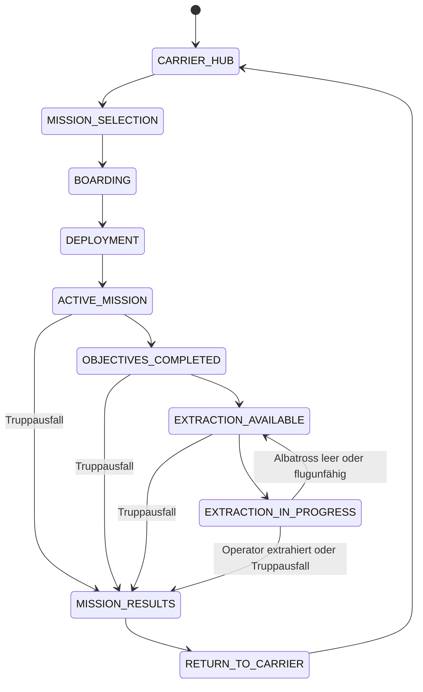

# Game Flow

## Architektur und Netzwerk

Der Audit ergab einen bestehenden Colyseus-Room mit fester `MissionInstance`, `Battlefield`-Tick und separater Arena. Der Meilenstein erweitert diese vorhandene Instanz. Boardingtimer und Flugphasen sind Teil desselben Zustands. ObjectiveManager, Encounter Director, PatrolManager, Nester, gemeinsame Waffen- und Bewegungslogik und der 1.000er-Gegner-ECS bleiben integriert. Die geschützten Schabe-Dateien stimmen mit den Baseline-Hashes überein.

| Kanal | Daten |
| --- | --- |
| `input` | Validierte Richtungen, Blickwinkel und Waffenimpulse. |
| `mission-selection`, `mission-start` | Host-Anfragen in Reichweite des Missionstischs. |
| `mission-interact`, `mission-action` | Positions- und phasenabhängige Handlungen. |
| `players` | 20 Hz. Operator mit Bewegung, Input-Bestätigung, Lebens-ID und Host-ID. |
| `mission-state` | 5 Hz plus Phasenwechsel. Auswahl, Operatorstatus, Flugphasen, Albatross, Convicts, Ballon und Ergebnis. |
| `horde-wide` | 10 Hz. Binäre Gegner-Snapshots mit zehn Bytes pro Gegner und sechs Bytes Header. |
| `mission-events` | Zustandsereignisse für Reaktion und Debug. Die Darstellung kann aus Snapshots rekonstruiert werden. |
| `metrics` | 2 Hz. Tickrate, Tickzeiten, verworfene Schritte und Entitäten. |

Positionswechsel nutzen den vorhandenen Lebenszähler zur Zurücksetzung der Prediction. Der Client blendet Carrier oder Oberfläche im vorhandenen Renderer ein und verwendet eigene Kameras für Fallflug, Touchdown und Rettung. Rückkehr nach zwölf Sekunden oder nach Zustimmung aller noch verbundenen Operator. Der Room und seine Einladungs-ID bleiben bestehen.

Der Room reserviert bei einem unerwarteten Verbindungsabbruch zwölf Sekunden. Reconnects erhalten dieselbe Session-ID und denselben Entitätenbestand. Die Host-Rolle geht bei einem Abbruch an die nächste bestehende Verbindung. Getrennte Operator werden aus Bereitschaft, Sicherung vor Fang und Rückkehrabstimmung nach dem Ergebnis entfernt. Wer vor der Abflugverriegelung getrennt bleibt, verpasst diesen Einsatz und wartet bei Reconnect bis zur Rückkehr. Wer nach dem Verriegeln getrennt wird, behält seinen Einsatzslot. Bereits gefangene Operator bleiben im Resultat. Neue Teilnehmer können bis zum Verriegeln und wieder auf dem Carrier beitreten.

## Prüfung und Grenzen

Mit `FREEFALL_MISSION_DEBUG=1 npm run dev` sind auf Loopback und außerhalb von Produktion die Host-Debugbefehle im Pausenmenü verfügbar. **F2** öffnet die Telemetrie, **F3** zeigt im Debug-Modus Routen. Die zusätzlichen automatisierten Fälle decken den Einsatzzyklus, Disconnects, Reconnects, Ausrüstung, zwei Extraktionsmethoden und EP-Grenzfälle ab.

Die Hauptrisiken sind szenenübergreifende Positionssprünge, unvollständige Room-Teilnahme und doppelte Finalisierung. Sie werden über gepaarte Phasen-/Spielersnapshots, serverseitige Teilnehmerprüfung und eine Finalisierung je Einsatz-ID kontrolliert. Produktionsbalancing, Persistenz, Authentifizierung, Session-Rückkehr über Browser-Neuladen, WAN-/Paketverlusttests und Hardware-Benchmarks auf Zielgeräten stehen aus. [Messungen](PERFORMANCE.md)

## Systemdokumente

- [Carrier](SKYFALL_CARRIER.md) und [Planetenregister](PLANET_REGISTRY.md)
- [Albatross 02](ALBATROSS_02.md) und [Deployment](DEPLOYMENT_SYSTEM.md)
- [Convict-System](CONVICT_SYSTEM.md) und [Narrative Vorbereitung](LORE/CONVICTS.md)
- [Extraktionssystem](EXTRACTION_SYSTEM.md) und [Extraktionsballon](EXTRACTION_BALLOON.md)
- [Missionsbelohnungen](MISSION_REWARDS.md)
