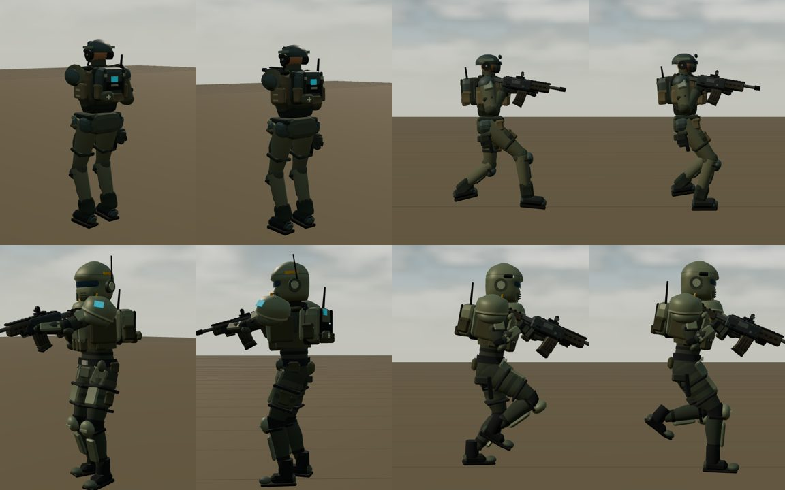
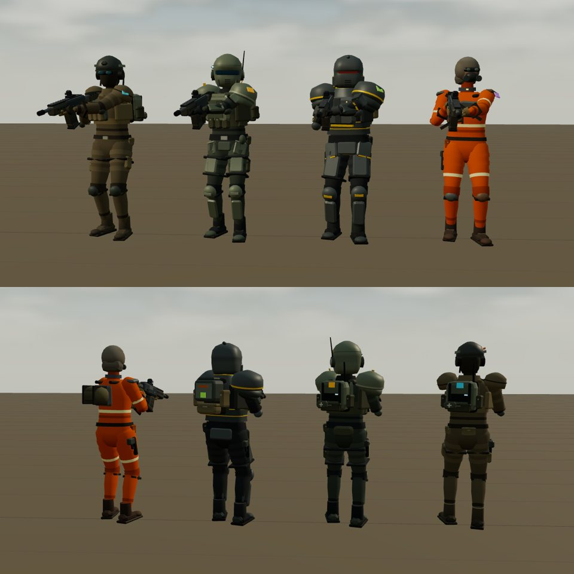
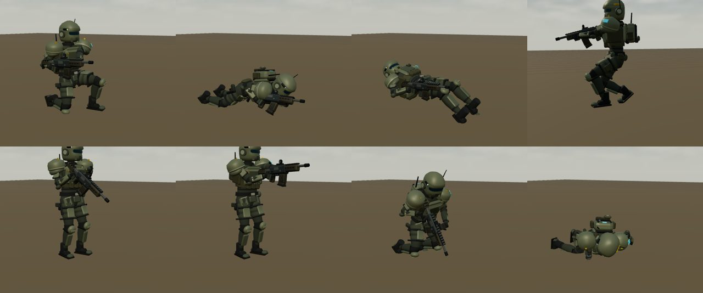
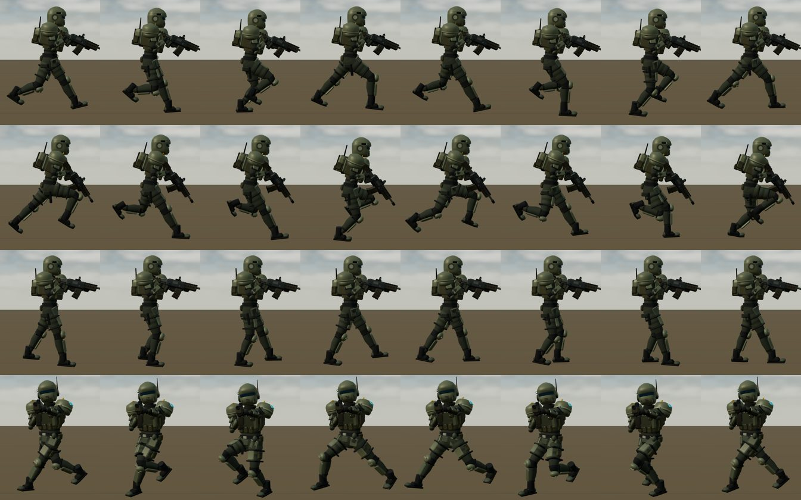

# Operator: Modell, Rüstungen und Animation

Stand 26. November 2026. Der Operator ist von starren, einzeln instanzierten Segmenten auf ein echtes Skelett mit geskinntem Körper umgestellt. Rüstung, Helm und Rucksack sind austauschbare Ausrüstungsteile, die die ganze Optik verändern. Die Bewegungen entstehen weiter prozedural und servergetaktet, aber auf 27 Knochen mit Zweigelenk-IK, Fußabrollen, Beckenbewegung, Wirbelsäulenverteilung und Feder-Sekundärbewegung.





## Überblick

| Baustein | Datei | Aufgabe |
| --- | --- | --- |
| Skelett | `characters/operator/OperatorSkeleton.ts` | 22 Humanoid-Knochen im FREEFALL-Schema plus 5 Hilfsknochen, Bindepose, Proportionen |
| Körper | `characters/operator/BodyLoft.ts` | Loft-Geometrie (Ringe mit Superellipsen-Querschnitt) und Gewichtsfunktionen für Rumpf, Hals, Arme, Beine |
| Garderobe | `characters/operator/Wardrobe.ts` | `PieceKit` zum Bauen von Ausrüstungsteilen, `OperatorWardrobe` setzt Looks zusammen und teilt sie |
| Katalog | `characters/operator/Catalog.ts`, `kit/*.ts` | Alle Rüstungen, Helme, Rucksäcke, Standard- und Häftlings-Look |
| Rig | `characters/operator/OperatorRig.ts` | Ein Skelett je Figur, geskinnte Meshes, Teammarker, Ausrüstungsanker und die komplette Pose |
| IK | `characters/operator/Limb.ts` | Zweigelenk-Lösung, Knochenausrichtung mit Drehachse, Scharniergelenke |
| Federn | `characters/operator/Springs.ts` | Gedämpfte Federn für Waffenträgheit, Treffer, Rucksack; deterministisches Rauschen |

`PlayerVisualController` bleibt die Schnittstelle für `PlayerView` (vier Operatoren) und `ConvictView` (Häftlinge). Der GLB-Pfad (`CharacterClipPlayer`, Retargeting, `SkeletonOverlay`) ist unverändert. Das prozedurale Skelett trägt dieselben Knochennamen wie ein FREEFALL-GLB, sodass spätere Rüstungsassets an beide Rigs passen.

## Skelett

Modellraum in Metern, Füße am Ursprung, −Z vorn, +X rechts. In der Bindepose haben alle Knochen die Einheitsrotation, Gliedmaßen hängen entlang −Y. Bei einem Gliedknochen zeigt lokal −Y zum Kind und −Z nach vorn. Die inversen Bindematrizen sind deshalb reine Verschiebungen.

| Kette | Knochen |
| --- | --- |
| Wirbelsäule | `Hips` (0,96 m) → `Spine` → `Chest` → `UpperChest` → `Neck` → `Head` |
| Arme | `Left/RightShoulder` (Schlüsselbein) → `UpperArm` (0,29 m) → `LowerArm` (0,26 m) → `Hand` |
| Beine | `Left/RightUpperLeg` (0,42 m) → `LowerLeg` (0,41 m) → `Foot` → `Toes` (Fußballen) |
| Hilfsknochen | `Left/RightPauldron` (folgt dem Oberarm zur Hälfte), `Left/RightTasset` (schwingt mit dem Oberschenkel nach vorn, nie zurück), `Backpack` (gefedert) |

Die Waffe hängt wie bisher an einem Waffenrahmen (`OperatorRig.torso`) am `UpperChest`. Er liegt an der Stelle des alten Torso-Ursprungs, daher gelten Waffensockets, Mündungsregeln und die taktischen Haltungen unverändert.

## Modell und Rendering

Jeder Look wird zu **einer geskinnten Geometrie pro Materialkanal** zusammengesetzt: `cloth` (Stoff, Gurtband, Stiefel, Metallanteil 0,04) und `plate` (lackierte Platten, Metallanteil 0,24). Starre Teile wie Platten, Taschen, Handschuhe oder Helmschalen sind zu 100 % an ihren Knochen gewichtet. Der Grundanzug, Gürtel, Kummerbund und die Bauchschienen des schweren Satzes sind über Gewichtsfunktionen weich an mehrere Knochen gebunden. Ellbogen, Knie, Hüfte, Taille und Hals verformen sich deshalb, statt aufzuklaffen. Ein Operator kostet unabhängig von der Teilezahl **zwei Draw Calls**. Alle Operatoren mit gleichem Look teilen dieselbe Geometrie.

Die Oberfläche nutzt weiter die Vertexattribute aus `ModelParts`: Farbe, `surface` (Rauheitsfaktor, Eigenleuchten) und die eingebrannte Fugenabdunklung. Lofts schattieren Falten und Unterseiten über Ringfaktoren. `ModelParts` kann dafür jetzt Teile mit Hautgewichten (`skinned`, `skin`), Versatz (`offset`), eigene Geometrie (`custom`) und Gier-Rotation für Boxen bauen.

Teammarker (HUD-Farbe) bleiben einzelne Meshes am Knochen. `PlayerRigBatches` instanziert weiter alle starren Teile (Waffen, Holster, Stim, Granate, Marker) und durchsucht die Rigs dafür jedes Bild, sodass Looks zur Laufzeit wechseln können. Geskinnte Körper rendern sich selbst. Ihre Weltmatrix trägt nur den Transport (Albatross-Abhebung, Ballonseil). Liegt das Rig außerhalb des Sichtkegels, werden sie ausgeblendet.

| Look | Dreiecke | Vertices (cloth + plate) | Aufbau |
| --- | ---: | ---: | ---: |
| SR-4 Späher (leicht) | 10.430 | 24.642 + 6.648 | 31 ms |
| FR-7 Feldpanzer (mittel, Standard) | 13.012 | 22.152 + 16.884 | 28 ms |
| BW-9 Bollwerk (schwer) | 12.484 | 13.020 + 24.432 | 21 ms |
| Gewahrsam (Häftlinge) | 7.832 | 20.748 + 2.748 | 11 ms |

Richtwert bleibt 25.000 Dreiecke und 80 Knochen pro Figur. Ein Look wird beim ersten Gebrauch einmal gebaut und danach geteilt.

## Rüstungssystem

Wie im Vorbild Helldivers bestimmt die Ausrüstung die Silhouette. Ein Look besteht aus drei Slots:

| Slot | Inhalt | Beispiele |
| --- | --- | --- |
| `armor` (Rüstung) | Grundanzug, Platten, Handschuhe, Stiefel, Gürtel, Holsterposition, Gewichtsklasse | `sr4` leicht, `fr7` mittel, `bw9` schwer, `gewahrsam` |
| `helmet` (Helm) | alles am Kopf, bei offenen Helmen auch Gesicht und Sturmhaube | `sr4-haube`, `fr7-helm`, `bw9-helm`, `gewahrsam-haube` |
| `pack` (Rucksack) | Teile am gefederten `Backpack`-Knochen, Teammarker, Anker für Beschriftungen | `funk`, `versorgung`, `seesack` |



**Netzvertrag.** `PlayerState.look?: OperatorLook` (`packages/shared/src/contracts/messages.ts`) trägt die drei IDs. Fehlt das Feld, trägt der Operator den Standard (`fr7`, `fr7-helm`, `funk`). Unbekannte IDs fallen slotweise auf den Standard zurück (`OperatorWardrobe.resolve`), ein älterer Client zeigt also bei neuen Teilen den Standard statt eines Fehlers. `PlayerView` setzt den Look jedes Bild aus dem Snapshot; ohne Änderung kostet das einen Vergleich. Seit 8.3A setzt der Server das Feld aus dem Loadout (`armors[].visual`, `backpacks[].visual`), sobald es vom Standard abweicht ([Rüstungssystem](RUESTUNGSSYSTEM.md)). `scripts/playtest-operator.mjs` zeigt am Carrier, dass ein Look Ende-zu-Ende ankommt.

**Neues Teil anlegen.** Ein `WardrobeItem` hat `id`, `slot`, Anzeigename, optional Gewichtsklasse und Beschreibung sowie `build(kit)`. In `build` beschreibt `PieceKit` das Teil:

```ts
export const MEIN_HELM: WardrobeItem = {
  id: 'mein-helm', slot: 'helmet', name: 'MK-2 Pionierhelm',
  build(kit) {
    kit.on('Head', (m) => {                       // knochenlokal: Ursprung = Bindeposition des Knochens
      hard(m, () => m.custom(loft([...ringe]), 0x58614f, false));
      lit(m, .3, () => m.box(0x132730, 0, .075, -.15, .13, .05, .02, .009));
    });
  },
};
```

| Methode | Zweck |
| --- | --- |
| `kit.on(knochen, zeichne, kanal)` | starre Formen an einem Knochen, Koordinaten relativ zu seiner Bindeposition |
| `kit.both(name, (m, seite) => …)` | dasselbe Teil links (−1) und rechts (1) gespiegelt, z. B. `Pauldron`, `LowerLeg`, `Hand` |
| `kit.skin(gewichte, zeichne, kanal)` | weich verformte Formen im Modellraum (`torsoWeights`, `armWeights`, `legWeights`, `neckWeights`) |
| `kit.marker(knochen, position, normale, größe)` | Teamfarben-Patch |
| `kit.anchor(slot, knochen, position)` | Ausrüstungsanker, z. B. Holster (`SecondaryWeapon`) oder Rucksack-Beschriftung |

Bausteine wie `suit`, `belt`, `torsoBand`, `pouch`, `glove`, `boot`, `toeCap`, `hard` und `lit` liegen in `kit/Parts.ts`. Danach das Teil in `WARDROBE` (`Catalog.ts`) eintragen. `apps/client/test/operator-rig.test.ts` prüft für die Beispiel-Looks Budget, Hautgewichte und Wechsel.

**Rüstungen spielwirksam machen.** Seit 8.3A sind die Schritte 1–3 für Rüstungspunkte umgesetzt ([Rüstungssystem](RUESTUNGSSYSTEM.md)); Tempo und Ausdauer sind als Konzept beschrieben. Ursprünglicher Plan:

1. Rüstungs-, Helm- und Rucksack-IDs mit Werten (Rüstungsklasse, Tempo-Faktor, Ausdauer, Passivbonus) in den Balance-Daten anlegen, mit denselben IDs wie im Katalog.
2. `LoadoutSelection` um `armorId`, `helmetId`, `packId` erweitern, im Account speichern und an der Ausrüstungsstation („Rüstung“-Raum des Carriers) wählbar machen.
3. `playerSnapshot` sendet `look` aus dem Loadout, nur wenn er vom Standard abweicht.
4. Optional die Gewichtsklasse an die Bewegung koppeln: `CompiledLook.weight` liegt im Rig bereits vor, etwa für tieferes Becken oder schwereren Schritt.
5. GLB-Teile: Ein produziertes Rüstungsasset wird auf das FREEFALL-Skelett geskinnt (gleiche Knochennamen und Bindepose, siehe [Asset-Anforderungen](CHARACTER_ASSET_REQUIREMENTS.md)) und kann als weiteres `WardrobeItem` dieselben Slots belegen.

## Animation



Gameplay besitzt weiter die Position. `CharacterAnimation` und `TacticalAnimation` liefern Gangphase, Haltungsgewichte und Aktionsfortschritt aus Prediction oder Snapshot. Lokale und fremde Operatoren laufen durch denselben Code, Servertakte (Nachladen, Ausrüstung, Haltungen, Hechtsprung) sind unverändert.

| Schicht | Verhalten |
| --- | --- |
| Gangzyklus | Stehphase 60 % beim Gehen, 30 % im Lauf (5,8 m/s), 23 % im Sprint. Die Schrittfrequenz steigt von 1,1 auf 2,0 Zyklen/s. Der Standfuß legt genau die Bodenstrecke zurück (Kontaktlänge höchstens 1,1 m). |
| Fuß | Fersenaufsatz mit angehobenen Zehen, flache Mitte, Abrollen über den Ballen, die Zehen bleiben dabei am Boden. Schwungphase: Ferse hoch hinter dem Körper, Knie zieht durch, Fuß greift vor und hebt die Zehen zum Aufsatz. Der Fuß hebt sich mit dem Tempo höher, im Lauf etwa 30 cm, im Sprint über 40 cm. |
| Becken | Federndes Absenken unter Last im Lauf, inverses Pendel beim Gehen, seitliches Pendeln zum Standbein, Hüftsenkung auf der Schwungseite, Gierbewegung mit dem Schritt. Schräg- und Seitwärtslauf drehen Becken und Füße in die Laufrichtung (bis 46°), Rückwärtslauf leicht schräg. |
| Wirbelsäule | Die Differenz zwischen Becken und Brust verteilt sich 36/34/30 % auf die drei Rumpfknochen. Die Brust bleibt zum Ziel ausgerichtet, während das Becken arbeitet. Vorlage im Lauf und Sprint, Beschleunigungs- und Bremsneigung über eine Feder mit leichtem Nachschwingen. |
| Gewehrhaltung | Der Oberkörper ist eingedreht (rechte Schulter zurück, 17–21°), die Waffe wird ohne diese Drehung geführt und zeigt geradeaus. Dadurch erreichen beide Hände Griff und Handschutz mit natürlichen Ellbogenwinkeln (rechts etwa 60°, links 130–140° im Anschlag). Beim Zielen geht der Kopf an den Schaft. |
| Arme | Schlüsselbein zieht zur Hand vor und hoch, danach Zweigelenk-IK auf das Handgelenk hinter dem Faustmittelpunkt. Die Faust schließt sich um den Griff entlang der Griffneigung, die Stützhand liegt mit der Handfläche nach oben unter dem Handschutz. |
| Waffe | Federn für Trägheit bei Beschleunigung, Drehung und Fußaufsatz, beim Zielen 70 % ruhiger. |
| Kopf | stabilisiert gegen das Wippen des Körpers, folgt dem Blick, schaut in Kurven voraus und in Ruhe gelegentlich umher. Liegend und im Fallen reitet der Kopf auf der Brust. |
| Ruhe | Atmen, langsame Gewichtsverlagerung mit entlastetem Knie, Mikrobewegung der Waffe. Die Füße stehen fest in der Welt. Dreht sich der Körper weiter als etwa 24° oder verschiebt er sich um 11 cm, setzt zuerst der weiter entfernte Fuß in 0,26 s nach. Nach einem Lauf stellen sich die Füße so von selbst wieder hin. |
| Hilfsknochen | Schulterschalen folgen dem Oberarm zur Hälfte, Beinschutz schwingt mit dem Oberschenkel nach vorn, der Rucksack federt bei jedem Aufsatz. |
| Gewicht und Erschöpfung | Die Gewichtsklasse der Rüstung (seit 8.3B) macht den Schritt schwerer oder federnder; bei leerer Ausdauer atmet der Operator schnell und tief und sackt im Stand nach vorn ([Rüstungssystem](RUESTUNGSSYSTEM.md#2-laufgeschwindigkeit-und-ausdauer-83b)). |
| Reaktionen | Treffer werfen die Brust zurück und verdrehen sie abwechselnd zu einer Seite (Feder statt starrer Neigung). Beim Tod knicken zuerst die Knie ein, dann kippt der Körper nach vorn, die Arme fallen schlaff zur Seite. |
| Hocke | In Ruhe Kniestand auf dem rechten Knie mit aufgestelltem linkem Fuß, in Bewegung Gang auf gebeugten Beinen. Rutschen, Bauch- und Rückenlage, Hechtsprung und Aufstehen nutzen dieselben Gewichte wie vorher, jetzt mit Knien und Füßen, die der Knochenrichtung folgen. |

Die Pose kostet im Mittel 0,034 ms pro Operator (`scripts/tactical-component-bench.ts`, p99 0,06 ms). `scripts/motion-bench.ts` zeigt unverändert 0,00 m/s Fußgleiten in den gleichförmigen Szenarien.

## Prüfen

| Prüfung | Befehl oder Ort |
| --- | --- |
| Rig, Looks, Budget, Hautgewichte, Griff, gepflanzte Füße, Lauf, alle Haltungen, Transport | `apps/client/test/operator-rig.test.ts` |
| Budget und Oberflächendaten | `apps/client/test/character-models.test.ts` |
| Spiel im Browser: Ruhe, Lauf, Sprint, Stopp, Seitwärts im Anschlag, Hocke, Hechtsprung, drei Rüstungen am Carrier | `PLAYWRIGHT_MODULE=… node --conditions=development scripts/playtest-operator.mjs [Ordner]` |

## Grenzen

- Finger sind als geschlossene Faust modelliert. Die Unterarmdrehung sitzt im Handknochen und wird von Stulpe und Unterarmschutz verdeckt.
- Die Füße stehen auf der Bodenebene der Figur. Auf geneigtem Gelände gibt es noch keine Fuß-IK pro Bein.
- Spieler werfen weiter Kontaktschatten statt Schattenkarten-Schatten, weil die Sonnenschatten nur für statische Geometrie aktualisiert werden.
- Helme sind an die Rüstung gebunden; eine getrennte Helmauswahl gibt es noch nicht.
