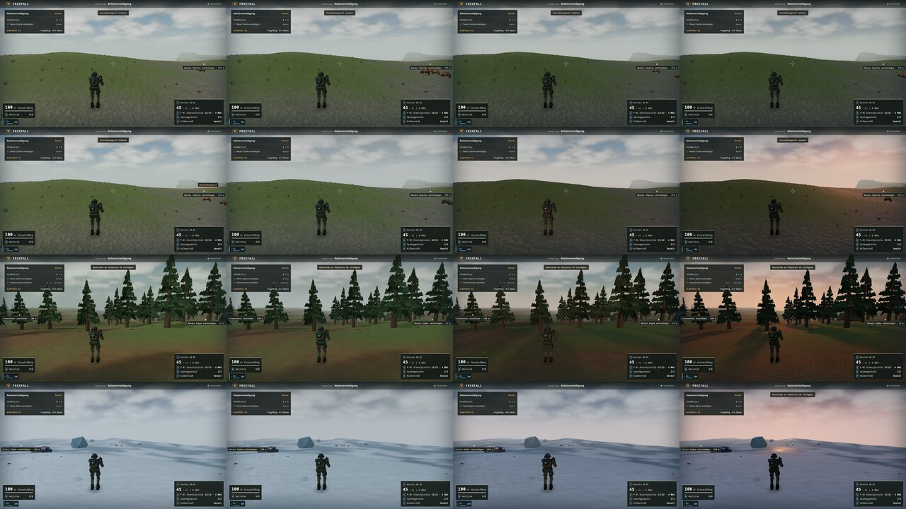

# Tageszeit · 7.7C

Die Missionskonsole bietet vier Tageszeiten für generierte Planeten. Der Host kann sie in den Plan übernehmen, bevor Boarding freigegeben wird. Der Tageszustand gilt für die gesamte Mission. Ein Plan ohne Feld erhält `day`. Ein explizites Preset beeinflusst den Plan-Hash und lässt Weltidentität, Geometrie, Objectives und Balance aus derselben Generierung bestehen.

| Preset | Wirkung |
| --- | --- |
| `day` | Bestehende Tagespalette des Planeten, Wettermodulation über Sonne, Fülllicht und Dunst |
| `overcast-day` | Schwache, weiße Sonne, kühles und stärkeres Fülllicht, mehr Umgebungslicht, entsättigter grauer Himmel |
| `dawn` | Tiefe rosig-goldene Sonne von der einen Seite (Azimut −1,15 rad), kühles blau-violettes Fülllicht, Pfirsich-Horizont, kühlerer Zenit |
| `dusk` | Sehr tiefe orange Sonne von der Gegenseite (Azimut +1,99 rad), lange Schatten und Gegenlicht, violettes Fülllicht, warmer Dunst, tiefblauer Zenit |

## Lichtstimmung je Tageszeit

`TIME_OF_DAY_LIGHT` in `AtmosphereController.ts` legt je Tageszeit Sonnenhöhe und -azimut, Sonnenfarbe und -stärke, Farben und Stärke des Himmels- und Bodenlichts, Umgebungslicht, Belichtung, Himmelshelligkeit, Entsättigung, Horizontglühen, Zenitfarbe und Dunstfarbe fest. Die Planetprofile bleiben Ausgangspunkt. Die Farben sind Zielwerte, zu denen das Profil gemischt wird, die übrigen Werte skalieren es. Bewölkung und Dunst dämpfen die Farbe der tiefen Sonne und das Horizontglühen.

Morgen- und Abenddämmerung stehen sich im Azimut genau gegenüber. Die Schattenkarte wird beim Wechsel neu berechnet. Weil die Tageszeit während eines Einsatzes fest ist, entsteht dabei kein laufender Mehraufwand. Der Himmels-Blend ergänzt einen warmen Horizontstreifen, der zur Sonne hin am stärksten ist. Er färbt auch die Wolken auf der Sonnenseite und zieht den Zenit kühler. Es gibt keine zusätzlichen Lichtquellen, Render-Durchgänge oder Draw Calls.

Lesbarkeit hat Vorrang. Die Tests prüfen für alle Planeten und Tageszeiten Belichtung (0,84–1,10), Mindeststärke der Sonne, Sonnenhöhe, Fülllicht von mindestens 75 % des Profils mit ausreichend heller Farbe und Umgebungslicht von mindestens 70 %.

Die Planetfarben und der Basishimmel bleiben Ausgangspunkt. Bei Bewölkung oder Dämmerung nutzt der Sky-Blend dieselbe equirektangulare Quelltextur. Das IBL bleibt als Textur fest, seine Stärke folgt der Tageszeit. Fog und Himmel verwenden dieselbe lineare Dunstfarbe. Der direkte ACES-Pfad rechnet Fog wie in 7.7A für die Ausgabe um. High verarbeitet Fog im bestehenden Output-Pass.

[Profile und Ausgabepfade](PLANET_ATMOSPHERE_PROFILES.md) · [Kampflesbarkeit](WEATHER_COMBAT_READABILITY.md)
